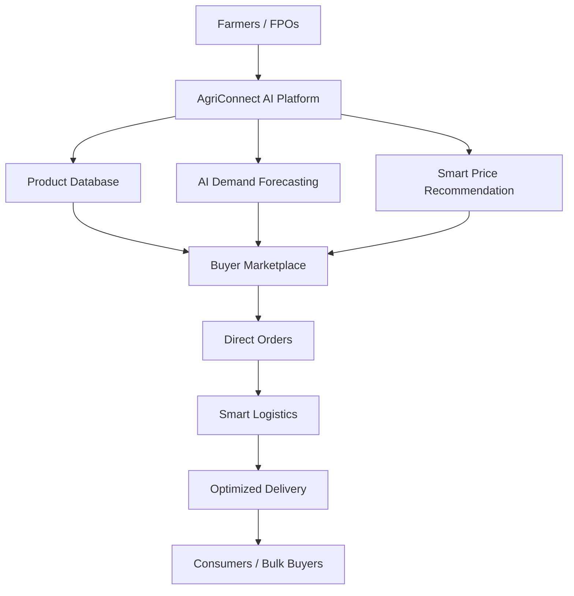

# Smart India Hackathon 2026

## SIH-26033: Multiple Intermediaries Reduce Farmers' Earnings and Increase Consumer Prices

**Project Name:** AgriConnect AI – Smart Direct Farm-to-Market Platform

**Date:** 30 October 2026

**Reference Number:** SIH-26033

**Name:** Hamsiha

---

## 1. Proposed Solution

AgriConnect AI is a smart digital agricultural marketplace designed to connect farmers, Farmer Producer Organizations (FPOs), retailers, bulk buyers and consumers directly.

The platform reduces unnecessary intermediaries by allowing farmers to list their agricultural products, update availability and negotiate prices directly with buyers.

### Key Features

1. Direct Marketplace: Farmers can sell crops directly to consumers and bulk buyers.
2. AI Demand Forecasting: Predicts future demand using previous sales and seasonal data.
3. Smart Price Recommendation: Suggests reasonable selling prices based on demand and market information.
4. Smart Logistics: Identifies suitable delivery routes to reduce transportation costs.
5. Digital Transparency: Provides product details, quantity, pricing and order status.
6. Farmer Rating System: Builds trust through buyer feedback and transparent transactions.

### Innovation and Uniqueness

Unlike ordinary agricultural marketplaces, AgriConnect AI combines demand prediction, price recommendations and logistics planning in one platform.

It also supports local language interfaces to make the platform easier for farmers to use.

---

## 2. Technical Approach

### Technologies Used

- Frontend: HTML, CSS, JavaScript and Bootstrap.
- Backend: Python and Django.
- Database: MySQL.
- Machine Learning: Python and Scikit-learn.
- Data Visualization: Chart.js.
- Maps and Routing: OpenStreetMap.

### System Workflow

1. Farmers register and create their profiles.
2. Farmers upload crop details, quantity and expected prices.
3. Buyers search and compare available products.
4. AI analyzes historical sales and seasonal information to forecast demand.
5. The system recommends suitable prices.
6. Buyers place orders directly with farmers.
7. The logistics module suggests optimized delivery routes.
8. Both parties track order status.

### Technical Architecture

### Implementation Methodology

The project will be developed in phases:

- Phase 1: User registration and authentication.
- Phase 2: Product listing and marketplace development.
- Phase 3: AI-based demand forecasting and price recommendations.
- Phase 4: Logistics and route optimization.
- Phase 5: Testing, security and deployment.

---

## 3. Feasibility and Viability

### Feasibility

AgriConnect AI can be developed using affordable and widely available open-source technologies.

The platform can initially be implemented in selected villages and expanded to other agricultural regions.

### Potential Challenges

1. Limited digital literacy among farmers.
2. Internet connectivity issues in rural areas.
3. Transportation and storage difficulties.
4. Inaccurate demand predictions due to insufficient data.

### Risk Management

- Provide a simple multilingual user interface.
- Support mobile-friendly access.
- Collaborate with local FPOs and logistics providers.
- Improve prediction accuracy using continuously updated data.
- Allow manual price and demand updates when AI data is insufficient.

### Viability

The platform can generate revenue through optional logistics service fees and affordable transaction charges while keeping farmer participation accessible.

---

## 4. Impact and Benefits

### Benefits to Farmers

- Better access to customers.
- Reduced dependency on intermediaries.
- Improved price transparency.
- Better market demand awareness.
- Increased opportunities for agricultural income.

### Benefits to Consumers

- Access to fresh agricultural products.
- Transparent product pricing.
- Reduced unnecessary distribution costs.
- Better product traceability.

### Economic and Environmental Impact

- Strengthens rural agricultural businesses.
- Supports local farmers and FPOs.
- Reduces unnecessary transportation.
- Helps minimize food wastage through demand forecasting.
- Encourages sustainable agricultural supply chains.

---

## 5. Research and References

1. National Agriculture Market (eNAM): https://enam.gov.in/
2. Small Farmers' Agribusiness Consortium (SFAC): https://sfacindia.com/
3. Food and Agriculture Organization (FAO): https://www.fao.org/
4. Django Documentation: https://docs.djangoproject.com/
5. Scikit-learn Documentation: https://scikit-learn.org/
6. OpenStreetMap: https://www.openstreetmap.org/

---

## Conclusion

AgriConnect AI aims to create a transparent and efficient agricultural marketplace by connecting farmers directly with buyers.

By combining artificial intelligence, digital commerce and smart logistics, the proposed platform aims to improve farmers' market access, reduce supply-chain inefficiencies and make agricultural products more accessible to consumers.
